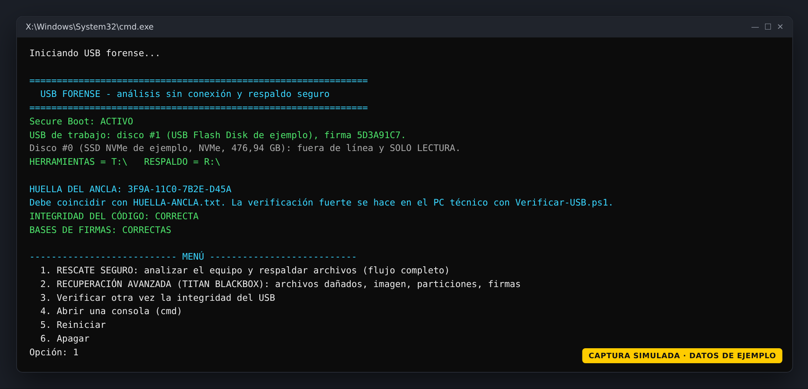
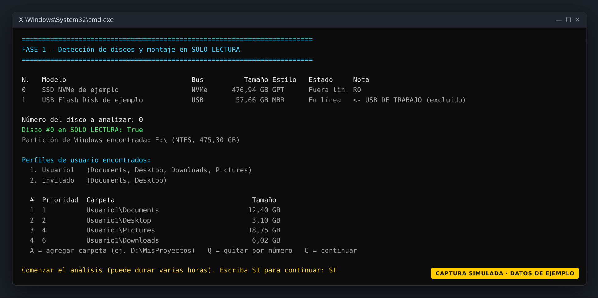
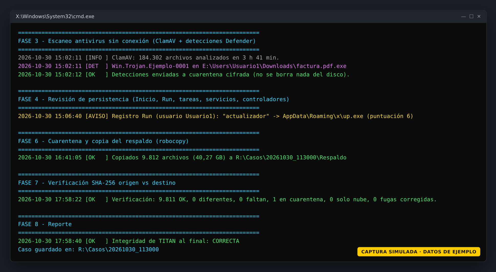
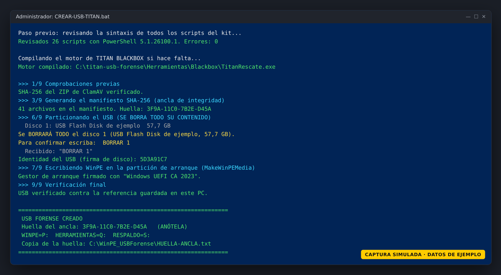

# TITAN · USB forense (WinPE)

**Mirar sin tocar.** TITAN convierte una memoria USB en un sistema de arranque (WinPE) para rescatar los archivos de un PC con Windows que ya no inicia o que puede estar infectado. Analiza el disco **sin ejecutar nada de él**, lo pone en **solo lectura**, busca malware y persistencia, copia los archivos a la USB y comprueba cada copia con **SHA-256**.

> ⚠️ Proyecto personal y en evolución, probado en pocos equipos. Úselo solo en equipos propios o con autorización del dueño. Antes de usarlo en un disco importante, ejecute las pruebas (`PROBAR-TITAN.bat` y `PROBAR-BLACKBOX.bat`) y lea la sección [Limitaciones](#limitaciones).

---

## Capturas

> Todas las capturas son **simuladas**: reproducen los textos reales de la herramienta con datos de ejemplo (discos, carpetas, huellas y fechas inventados).

| Menú al arrancar desde la USB | Fase 1: discos en solo lectura |
|---|---|
|  |  |

| Fases 3 a 8: antivirus, copia y verificación | Creación de la USB en el PC técnico |
|---|---|
|  |  |

---

## Qué hace

**Opción 1 · RESCATE SEGURO** (flujo completo en 8 fases):

| Fase | Qué hace |
|---|---|
| 0 | Comprobaciones previas (Secure Boot, identidad de la USB, integridad del código) |
| 1 | Detecta los discos y pone el disco elegido en **SOLO LECTURA** antes de montarlo |
| 2 | Revisa el sistema de archivos (`chkdsk` sin reparar) y la salud del disco (SMART) |
| 3 | Escaneo antivirus sin conexión con **ClamAV** (+ detecciones importadas de Microsoft Defender, opcional) |
| 4 | Revisión de persistencia: Inicio, claves Run, tareas programadas, servicios, controladores |
| 5 | Inventario de archivos con SHA-256 y heurísticas (doble extensión, etc.) |
| 6 | Lo sospechoso va **cifrado** a Cuarentena; el resto se copia a la USB con `robocopy` |
| 7 | Verificación **SHA-256 origen vs. destino** de cada archivo copiado |
| 8 | Reporte en HTML, TXT y CSV |

**Opción 2 · RECUPERACIÓN AVANZADA (TITAN BLACKBOX)**, para discos dañados: copia archivo por archivo con reintentos limitados y mapa reanudable, imagen del disco completo, búsqueda de particiones perdidas y recuperación por firma (JPEG, PNG, GIF, PDF, ZIP/Office, SQLite, MP4/MOV). El motor es un programa propio en C# (`Herramientas/Blackbox/TitanRescate.cs`) que se compila en su PC.

**Reglas que el kit aplica siempre:** el disco analizado nunca se escribe, nunca se ejecuta nada de él y nunca se borra nada. Detalles en [GUIA.md](GUIA.md) y [AUDITORIA-SEGURIDAD.md](AUDITORIA-SEGURIDAD.md).

---

## Qué necesita

### En el PC técnico (un PC sano con Windows 10/11 de 64 bits)

| Qué | Dónde se consigue | Obligatorio |
|---|---|---|
| Permisos de administrador | — | Sí |
| **Windows ADK** (marque solo *Deployment Tools*) | [learn.microsoft.com › ADK](https://learn.microsoft.com/windows-hardware/get-started/adk-install) | Sí |
| **Complemento WinPE para el ADK** (*Windows PE add-on*) | Misma página que el ADK | Sí |
| **ClamAV 1.5.4 para Windows x64** (`clamav-1.5.4.win.x64.zip`) | [GitHub de ClamAV › release 1.5.4](https://github.com/Cisco-Talos/clamav/releases/tag/clamav-1.5.4) | Sí |
| Microsoft Visual C++ 2015-2022 Redistributable (x64) | [learn.microsoft.com › VC++ Redistributable](https://learn.microsoft.com/cpp/windows/latest-supported-vc-redist) (normalmente ya está instalado) | Sí |
| .NET Framework 4.x (para compilar el motor BLACKBOX) | Viene con Windows 10/11 | Sí |
| Conexión a Internet (descarga de firmas de ClamAV) | — | Sí, al crear y al actualizar |
| smartmontools (`smartctl.exe`) | [smartmontools.org](https://www.smartmontools.org) | No (da más detalle de salud del disco) |
| Unos 5 GB libres en `C:` | — | Sí |

### La memoria USB

- **64 GB o más.** Al crearla **se borra entera**.
- Queda con 3 particiones: `TITAN-BOOT` (FAT32, 2 GB, arranque), `TITAN-TOOLS` (NTFS, 8 GB, herramientas) y `TITAN-USB` (NTFS, el resto, para los respaldos).

### En el PC dañado

- Arranque UEFI desde USB. Mejor con 8 GB de RAM o más (ClamAV carga sus firmas en memoria).
- Si el disco tiene BitLocker, la **clave de recuperación** de 48 dígitos (se consulta desde otro equipo en account.microsoft.com/devices/recoverykey).

---

## Instalación paso a paso

1. **Descargue el kit.** Botón verde **Code → Download ZIP** y extraiga la carpeta en `C:\titan-usb-forense` (o use `git clone`).
2. **Desbloquee los archivos** (Windows marca lo que viene de Internet). Abra PowerShell y ejecute:
   ```powershell
   Get-ChildItem C:\titan-usb-forense -Recurse | Unblock-File
   ```
3. **Instale el Windows ADK y el complemento WinPE** (los dos instaladores). Si falta alguno, `CREAR-USB-TITAN.bat` se lo avisa y abre la página oficial.
4. **Descargue ClamAV** y guarde el ZIP **sin descomprimir y con su nombre original** en la carpeta `Descargas` del kit:
   ```
   C:\titan-usb-forense\Descargas\clamav-1.5.4.win.x64.zip
   ```
   El script comprueba su SHA-256 (`0D9E0228B2674137EA1A2853566C98A0278AD52AB2582C3D6DBD75373848C395`). Si el archivo no coincide, se detiene.
5. **(Recomendado) Pruebe el kit en su PC**, sin tocar discos reales:
   - `PROBAR-TITAN.bat` → simulacro del análisis sobre un disco falso. Resultado en `prueba_titan.txt`.
   - `PROBAR-BLACKBOX.bat` → pruebas del motor BLACKBOX con discos virtuales desechables. Resultado en `prueba_blackbox.txt`. Si Windows pide formatear un disco durante la prueba, pulse **Cancelar**.
6. **Conecte la USB** y haga doble clic en **`CREAR-USB-TITAN.bat`**. Acepte el aviso de administrador. El proceso:
   revisa la sintaxis de los scripts → compila el motor BLACKBOX → crea WinPE → particiona la USB (le pide escribir `BORRAR <número>`) → copia las herramientas → descarga y verifica las firmas de ClamAV → verifica la USB completa.
7. **Anote la huella del ancla** que aparece al final (por ejemplo `3F9A-11C0-7B2E-D45A`). Es la que la USB le mostrará al arrancar.
8. **No borre `C:\WinPE_USBForense\`**: guarda las referencias con las que se verifica la USB más adelante.

> Uso avanzado: `CREAR-USB-TITAN.bat` llama a `Construir\Crear-USB.ps1` con las opciones habituales. Ese script acepta más parámetros (`-Smartctl`, `-Controladores`, `-ActualizacionAcumulada`, `-CertificadoArranque 2011`, `-DiscoUSB`…). Ver [GUIA.md](GUIA.md), sección 3.

---

## Uso en el PC dañado

1. Apague el equipo, conecte la USB y entre al menú de arranque (F12, F11, F9, F8 o Esc, según la marca). Elija la USB en modo **UEFI**. Deje **Secure Boot activado**; si aparece *Secure Boot Violation*, vea la sección 4 de [GUIA.md](GUIA.md).
2. TITAN arranca solo, sin red, y comprueba su propia integridad. Compare la **huella** que muestra con la que anotó.
3. Elija una opción del menú:
   - **1. RESCATE SEGURO** – el flujo completo de 8 fases (puede tardar varias horas: conecte el cargador).
   - **2. RECUPERACIÓN AVANZADA (TITAN BLACKBOX)** – para discos con sectores dañados o particiones perdidas.
   - **3.** Verificar otra vez la integridad · **4.** Consola · **5.** Reiniciar · **6.** Apagar.
4. Siga las preguntas: elija el disco, confirme con `SI`, revise perfiles y carpetas (A = agregar, Q = quitar, C = continuar).
5. Al terminar, el caso queda en la USB en `TITAN-USB\Casos\<fecha>\` (`Respaldo`, `Cuarentena`, `Datos`, `Registros`, `Reporte`).

## Después del rescate (en un PC sano)

1. **No abra el respaldo en el PC analizado.** Hágalo en un equipo sano.
2. Ejecute **`VERIFICAR-RESPALDO.bat`**: compara cada archivo copiado con el inventario SHA-256 del disco original.
3. Abra `Casos\<fecha>\Reporte\reporte.html` y revise malware, persistencia y estado de cada archivo.
4. Antes de abrir los archivos, analícelos con Microsoft Defender (clic derecho → *Examinar con Microsoft Defender*). Cada copia lleva la "Marca de la Web", así que Office los abre en Vista protegida.
5. Antes de usar la USB en otro equipo: **`LIMPIAR-RESPALDOS.bat`** y, si cambió algo del kit, **`ACTUALIZAR-TITAN.bat`**.

---

## Los archivos .bat

Todos se ejecutan con doble clic desde la carpeta del kit, en el **PC técnico**, nunca en el equipo analizado. Los que lo necesitan piden permisos de administrador solos.

| Archivo | Para qué sirve | ¿Borra algo? |
|---|---|---|
| `CREAR-USB-TITAN.bat` | Crea la USB TITAN desde cero (WinPE + herramientas + firmas). | **Sí, toda la USB elegida** (pide escribir `BORRAR <n>`) |
| `ACTUALIZAR-TITAN.bat` | Copia a la USB los scripts o la configuración que usted cambió y vuelve a sellar la integridad. Antes comprueba que la USB no fue alterada. | No borra respaldos |
| `PROBAR-TITAN.bat` | Simulacro completo del análisis en su PC con un disco falso. Resultado: `prueba_titan.txt`. | No (solo temporales propios) |
| `PROBAR-BLACKBOX.bat` | Pruebas del motor BLACKBOX con discos virtuales desechables. Resultado: `prueba_blackbox.txt`. | No (solo los discos virtuales de prueba) |
| `VERIFICAR-RESPALDO.bat` | Comprueba con SHA-256 que el último respaldo es idéntico al original. Solo lee la USB. | No |
| `LIMPIAR-RESPALDOS.bat` | Deja la USB lista para otro equipo: borra los casos de la partición `TITAN-USB`. No toca las herramientas. | **Sí, los casos** (pide escribir `BORRAR`) |
| `REPARAR-RESPALDOS.bat` | Si la partición de respaldos quedó dañada: `chkdsk /f` solo en `TITAN-USB` y borra los restos de `Casos`. | **Sí, restos dañados** (pide escribir `REPARAR`) |
| `DIAGNOSTICAR-USB.bat` | Diagnóstico de solo lectura cuando Windows no reconoce bien una USB. Resultado: `diagnostico_usb.txt`. | No |
| `ORGANIZAR-USB.bat` | Utilidad aparte: mueve todo el contenido de una USB a una carpeta `ARCHIVOS`, la renombra a `TITAN-USB` y la prueba. Pide la letra de la unidad y guarda un registro para deshacer. | No borra archivos |
| `Herramientas\INICIAR.bat` | Va dentro de la USB. Solo funciona arrancado en WinPE: vuelve a abrir el menú. | No |

### Scripts de PowerShell útiles (carpeta `Construir`)

| Script | Uso |
|---|---|
| `Verificar-USB.ps1` | Verificación fuerte de la USB contra las referencias guardadas en el PC. Antes y después de cada uso. |
| `Actualizar-Firmas.ps1` | Actualiza las firmas de ClamAV en la USB (antes de cada uso, con Internet). |
| `Escanear-Con-Defender.ps1` | Opcional: segunda opinión con Microsoft Defender conectando el disco dañado a un PC sano. |
| `Restaurar-Cuarentena.ps1` | Descifra un archivo de la cuarentena. **Solo dentro de una máquina virtual aislada.** |

Ejemplo (PowerShell como administrador):
```powershell
cd C:\titan-usb-forense\Construir
powershell -NoProfile -ExecutionPolicy Bypass -File .\Verificar-USB.ps1
```

---

## Configuración

`Herramientas\Scripts\config.json` define qué carpetas se respaldan, las prioridades de BLACKBOX y los límites de ClamAV. Si lo cambia, ejecute `ACTUALIZAR-TITAN.bat` para volver a sellar la USB (si no, la verificación de integridad lo detecta y bloquea el análisis). La tabla completa de opciones está en [GUIA.md](GUIA.md), sección 5.

## Estructura del repositorio

```
titan-usb-forense\
├─ *.bat                  ← accesos directos para el PC técnico (ver tabla)
├─ GUIA.md                ← guía técnica completa
├─ AUDITORIA-SEGURIDAD.md ← modelo de amenazas y medidas aplicadas
├─ Ancla\                 ← verificador que va DENTRO de boot.wim (X:\Ancla)
├─ Construir\             ← scripts del PC técnico (crear, verificar, probar…)
├─ Descargas\             ← aquí va el ZIP de ClamAV (no se incluye)
├─ Herramientas\          ← lo que se copia a la partición TITAN-TOOLS
│  ├─ Scripts\            ← analizador (8 fases), BLACKBOX y librerías
│  ├─ Blackbox\           ← código fuente del motor TitanRescate (C#)
│  ├─ ClamAV\             ← se llena al crear la USB
│  └─ Smartmontools\      ← opcional: smartctl.exe
└─ docs\capturas\         ← capturas simuladas
```

**No se incluyen binarios de terceros** (ClamAV, smartctl) ni el motor compilado (`TitanRescate.exe`): cada usuario descarga los oficiales y el motor se compila desde el código fuente en su propio PC.

---

## Limitaciones

- Ningún antivirus lo detecta todo. TITAN reduce el riesgo, no lo elimina: revise el reporte y analice el respaldo en un equipo sano antes de abrirlo.
- La comprobación de integridad que se hace dentro de WinPE es rápida y la calcula código de la propia USB. La verificación **fuerte** es `Verificar-USB.ps1` en el PC técnico.
- El desbloqueo de BitLocker está implementado pero todavía no se ha validado en un equipo real. Sin la clave de recuperación no se puede leer un disco cifrado.
- Equipos con Intel VMD/RST pueden no mostrar el disco interno sin el controlador adecuado (ver [GUIA.md](GUIA.md), sección 8).
- La recuperación avanzada (BLACKBOX) es un motor propio y sencillo. TITAN **no integra** GNU ddrescue, TestDisk, PhotoRec ni The Sleuth Kit; para casos graves, esas herramientas o un laboratorio profesional siguen siendo la mejor opción. Si el disco hace ruidos o se desconecta, deténgase: cada lectura puede empeorarlo.
- Las heurísticas pueden marcar software legítimo como sospechoso (falsos positivos).

## Licencia

Código del kit bajo licencia [MIT](LICENSE). ClamAV y smartmontools son proyectos independientes con sus propias licencias (GPL v2) y se descargan por separado desde sus sitios oficiales.
